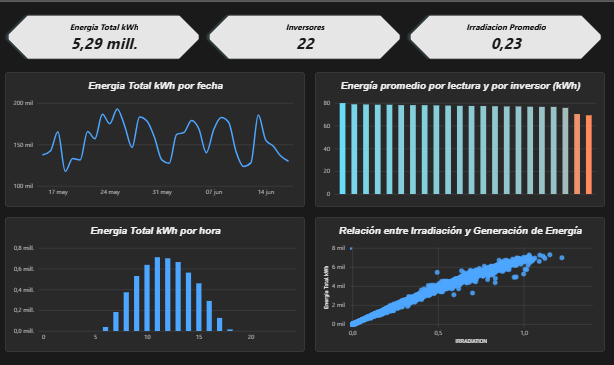
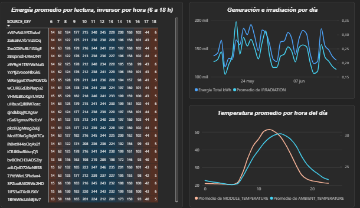
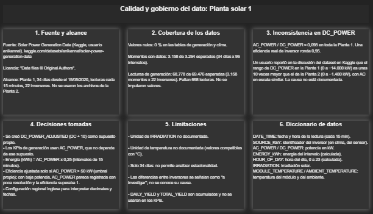

# Dashboard de generación solar: Planta 1

Dashboard en Power BI sobre la generación de una planta solar, con datos de clima.
Proyecto personal de práctica con Power Query, modelado de datos y DAX.

**Summary (EN):** Power BI dashboard analysing inverter-level generation and weather
data from a solar plant (22 inverters, 34 days, 15-minute readings). Includes data
preparation in Power Query, a two-table model, DAX measures and a documented
data quality review.

## Preguntas que responde
- ¿Cuánta energía genera la planta y cómo varía por día y por hora?
- ¿Cómo se relaciona la generación con la irradiación?
- ¿Hay inversores que rinden por debajo del resto, y en qué horas?
- ¿Qué tan completos y consistentes son los datos?

## Fuente de datos
[Solar Power Generation Data](https://www.kaggle.com/datasets/anikannal/solar-power-generation-data)
(Kaggle, usuario anikannal). Licencia indicada: "Data files © Original Authors".
Se usaron los archivos de la Planta 1 (generación y sensores de clima):
34 días desde el 15/05/2020, lecturas cada 15 minutos, 22 inversores.
Los datos originales no se incluyen en este repositorio.

## Qué se hizo
**Power Query**
- Corrección de la configuración regional (punto decimal y fechas día/mes/año).
- Columnas calculadas: fecha, hora del día, energía en kWh (AC_POWER x 0,25),
  DC ajustada y eficiencia ajustada.
- Eliminación de columnas constantes (PLANT_ID, y SOURCE_KEY en clima).

**Modelo**
- Dos tablas (`Generacion_P1`, `Clima_P1`) relacionadas por `DATE_TIME`
  (varios a uno, con el filtro de clima hacia generación).

**Medidas DAX**
- Energía total (kWh), energía promedio por lectura, cantidad de inversores,
  irradiación promedio.

## Páginas
### 1. Resumen de generación: 
KPIs, generación diaria, comparación entre inversores, generación por hora y relación irradiación-generación.

### 2. Clima y rendimiento por inversor:
matriz inversor por hora, generación e irradiación por día, temperatura por hora del día.

### 3. Calidad y gobierno del dato:
fuente, cobertura, inconsistencias, decisiones y diccionario.

## Hallazgos
- Generación total en el período: ~5,29 millones de kWh.
- La generación sigue de cerca a la irradiación y se concentra alrededor del mediodía.
- Dos inversores rinden ~10 % menos por lectura que el resto (~69-70 kWh contra
  76-80). La causa es desconocida y requiere investigación.
- La temperatura del módulo supera a la del ambiente en las horas centrales.

## Calidad de datos y limitaciones
- 0 % de nulos; cobertura incompleta: 3.158 de 3.264 momentos esperados y
  68.778 de 69.476 lecturas esperadas (no se imputó).
- **Inconsistencia en DC_POWER:** AC/DC ≈ 0,098 en toda la planta, no compatible con una eficiencia típica de inversor (~0,95). Otro usuario reportó en la discusión del dataset que el rango de DC en la Planta 1 es ~10 veces mayor que en la Planta 2. La causa no está documentada.
  - El dato original no se modificó. Se creó una columna ajustada (DC ÷ 10) como **supuesto propio**, y los KPIs de generación usan AC_POWER.
- Unidades de irradiación y temperatura no documentadas (temperatura compatible con °C).
- Solo 34 días: no permite analizar estacionalidad.

## Herramientas
Power BI Desktop, Power Query, DAX.

